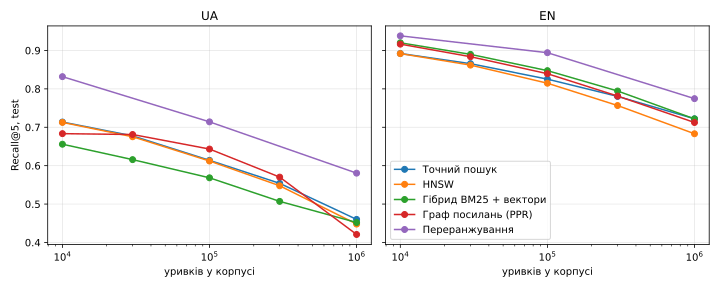

# RAG Scale Lab

How fast does retrieval quality in a RAG system fall as the corpus grows, and what brings it back?

This repository measures retrieval and answer quality on nested Wikipedia corpora from 10 thousand to 1 million passages, compares ten retrieval methods, and tests three ideas: a Ukrainian benchmark with evidence in native Wikipedia text, a degradation law registered before the 1-million measurement, and a query router that pays for an expensive method only when a cheap probe says it will help. Ukrainian Wikipedia is the main experiment; English HotpotQA is a control.



## Findings

1. **Retrieval degrades for every method.** Exact search loses 0.25 Recall@5 on the Ukrainian benchmark and 0.17 on the English one between 10 thousand and 1 million passages.
2. **The loss comes from retrieval, not from reading.** When the evidence is in the prompt, the generator fails equally often at every corpus size.
3. **Reranking and a lemmatized BM25 hybrid help.** At 1 million Ukrainian passages reranking reaches 0.58 Recall@5 against 0.45 for HNSW; the hybrid with lemmas reaches 0.52 without a cross-encoder.
4. **Hyperlink-graph expansion and a LoRA-tuned encoder do not.** On the Ukrainian benchmark the graph gives a significant gain at one corpus size only, and on the English one only for bridge questions, which were built by following a link; the adapter makes retrieval worse in both languages.
5. **A router recovers about half to two thirds of the reranking gain for a third to half of its latency**, and beats random routing with the same budget.
6. **The registered law is a fair forecast for random growth and a poor one for adversarial growth**, where a naive last-value forecast is closer.

The full report with tables and confidence intervals is in [reports/report_uk.md](reports/report_uk.md) (Ukrainian). The protocol is in [docs/METHODS.md](docs/METHODS.md).

## Reproduce

```sh
git clone https://github.com/dbulgakov/ua-rag-scale && cd ua-rag-scale
uv sync
uv run raglab report            # rebuild the report and figures from results/ in seconds
```

The whole pipeline is one command; finished stages and cells are skipped on restart:

```sh
export OPENROUTER_API_KEY=...   # only for the generation stage, about $1.3
uv run raglab run all
```

`--out <dir>` moves `work/`, `results/` and `reports/` to another directory. `--sizes 10000` limits the retrieval grid, reranking and latency to the given corpus sizes (repeat the option for several) as a quick check: the pools are still built and encoded in full, and the report needs all five sizes.

| Stage | Command | What it does |
|---|---|---|
| Data | `raglab data` | Downloads the raw sources, chunks Wikipedia, builds both 1M pools and link graphs, and checks them against the pinned ids |
| Embeddings | `raglab embed` | Encodes passages and questions; evaluates the external anchor |
| LoRA | `raglab finetune` | Mines hard negatives, trains the adapter, encodes with it |
| Retrieval grid | `raglab grid` | Every method on 5 sizes × 2 growth orders × 3 seeds |
| Reranking | `raglab rerank` | Cross-encoder over HNSW candidates |
| Latency | `raglab grid --latency`, `raglab rerank --latency` | Isolated single-query timing |
| Generation | `raglab generate` | No retrieval, retrieval and oracle answers through OpenRouter; `--local` runs the MLX control (`uv sync --extra mlx`) |
| Report | `raglab report` | Tables, intervals, law check, router, figures |
| Demo | `raglab serve` | Ukrainian question answering with an HNSW walk-through (build the page first: `cd web && pnpm install && pnpm build`) |

A GPU and about 20 GB of RAM are needed in practice; `--device cuda|mps|cpu` overrides the detected device. [notebooks/colab.ipynb](notebooks/colab.ipynb) runs the retrieval stages on Google Colab without any secret; every stage leaves an archive of `results/` in `/content`, and the last cell downloads the final one. Generation then runs locally: `raglab data` rebuilds the passage texts, `raglab generate` answers, `raglab report` writes the report.

## Reproducibility

The tables in `results/` come from a full rerun of the published code on 2026-11-16: the retrieval stages on Google Colab (L4 GPU, high-RAM runtime, about 7 h 40 min) and generation on a laptop (about $1.3 through OpenRouter). The rerun was compared with the tables of the original run, which was computed on an Apple M3 Max and is kept in commit `57de63d`. The full comparison is in [results/gate_original_vs_recompute.txt](results/gate_original_vs_recompute.txt).

What matched:

- **Data.** Corpora, pools, link graphs and question sets: all 22 data counts are identical.
- **Deterministic retrieval.** Exact search, HNSW, adaptive HNSW, the three graph variants and the lemma hybrid give identical Recall@5 in every cell that both runs have.
- **Conclusions about retrieval.** All 56 paired retrieval differences and both router-versus-random differences keep their sign and significance; the law-versus-last-value verdict is the same in all four blocks.
- **Local control.** The MLX model repeats all 1,000 answers word for word, so the prompts are the same.

What differed and why:

- **Generator.** The provider does not repeat its answers at temperature 0 with a fixed seed: 84% of 10,400 answers are identical (55.5% and 75.5% of the no-retrieval answers, where the prompt is certainly the same). In the table "rerank − HNSW" 4 of 18 significance marks changed, all for EM or lemma EM on 200 questions; every difference keeps its sign and the F1 marks are unchanged.
- **IVF-PQ** differs between platforms: Recall@5 averaged over seeds moves by up to 0.009, less than its spread over seeds (up to 0.05). One observation crossed the edge of a forecast interval, so the log-linear law now covers 20 of 36 observations instead of 19.
- **LoRA** is trained again, which moves Recall@5 by up to 0.004. Hybrid search and reranking move by less than 0.002.
- **Lemma hybrid** is now run with three seeds; the original run had seed 42 only.
- **Headline numbers.** Of 360 fractions and percentages, 50 moved by more than 0.01 (one point for percentages); 49 of them are inside the 95% interval of the original run, and the last one is the law refit gap, which has no interval.
- **Latency** was measured on the Colab machine and is not compared: index search on its CPU is 1.4–8 times slower than on the M3 Max, the reranker on the L4 is 3.3–4.5 times faster.

## Layout

```
data/        benchmark, judge responses and pinned pool definition (CC BY-SA 4.0)
results/     per-question result tables; everything in reports/ is built from them
reports/     Ukrainian report, figures, and the registered forecast
docs/        METHODS.md
notebooks/   colab.ipynb
src/raglab/  config · data/ · embed · index · grid · rerank · finetune · evaluate · generate · router · law · anchor · report (+ templates/) · cli · api
tests/       chunking and ids, metrics, bootstrap, PageRank against networkx, router leakage
web/         demo front end
```

Heavy artifacts (corpus texts, embeddings, indexes, caches) are not stored; `raglab data` and `raglab embed` rebuild them under `<out>/work/`.

## Data and licenses

- Code: MIT.
- `data/` and passage texts: CC BY-SA 4.0. Questions come from [UA-SQuAD](https://huggingface.co/datasets/FIdo-AI/ua-squad) and [HotpotQA](https://hotpotqa.github.io/); passages come from Wikipedia. See [data/README.md](data/README.md).

## Checks

```sh
uv run ruff check . && uv run ruff format --check .
uv run pytest
```
