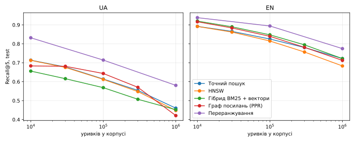
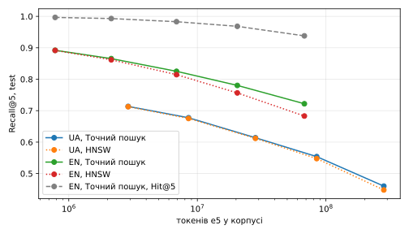
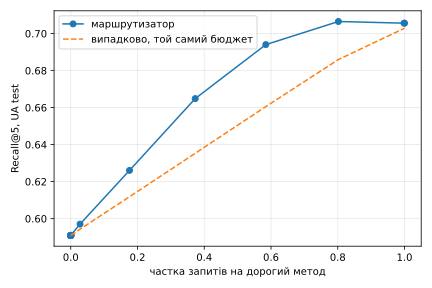

# Деградація якості пошуку в RAG-системах при зростанні корпусу та графові методи її компенсації

Звіт зібрано командою `raglab report` з таблиць у `results/`. Метод описано в `docs/METHODS.md`. Усі довірчі інтервали — 95%, кластерний bootstrap за еталонними статтями. Позначка «↑» означає, що інтервал різниці вище нуля, «↓» — нижче нуля.

**Метрики пошуку.** Recall@k — частка доказів питання, знайдених у топ-k, усереднена за питаннями. В UA кожне питання має один доказ (групу уривків з відповіддю), тож Recall@k — це частка питань, для яких доказ є в топ-k. В EN (HotpotQA) доказ — це одне опорне речення (supporting fact), і тестове питання має від 2 до 7 доказів. Тому в EN Recall@k — це ймовірність знайти один конкретний доказ, а абзац із кількома опорними реченнями має більшу вагу. Мови порівнюються за Recall@k, тобто «на один доказ». Поруч наведено два межові означення: Hit@k (у топ-k є хоча б один доказ; в EN це кілька шансів на питання) і «усі докази в топ-k». Завжди Hit@k ≥ Recall@k ≥ «усі докази», а в UA всі три збігаються. MRR@10 — обернений ранг першого еталонного уривка в топ-10; у кожному рядку таблиці результатів виконується Hit@1 ≤ MRR@10 ≤ Hit@10.

## Головні висновки

1. **Деградація.** Якість пошуку падає з розміром корпусу в усіх методів. На наших бенчмарках крива UA крутіша за одним доказом (Recall@5 точного пошуку від 10 тис. до 1 млн уривків: UA −0,253, EN −0,170) і за Hit@5 (EN −0,059, стеля 0,997, від 2 до 7 шансів на питання), але не за «усі докази в топ-5» (EN −0,285); це порівняння бенчмарків, а не мов. Для випадкового росту закон, підігнаний до 300 тис., прогнозує 1 млн точніше за наївний прогноз.
2. **Причина — пошук, а не читання.** Зі зростанням корпусу збільшуються помилки пошуку. Якщо еталон потрапив у промпт, частота помилок генератора майже стала (UA 0,466 → 0,472 → 0,462).
3. **Працюють переранжування і лематизований гібрид.** Переранжування: UA 0,581 проти 0,448 у HNSW на 1 млн. Гібрид із лематизованим BM25: 0,516 проти 0,460 у точного пошуку.
4. **Граф і LoRA не працюють.** В UA граф дає достовірний приріст лише на 100 тис. (+0,031), на 1 млн він не кращий за HNSW; в EN граф додає другий доказ (Recall@5) лише на bridge-питаннях, побудованих переходом за посиланням, а Hit@5 майже не змінює. LoRA погіршує пошук в обох мовах.
5. **Маршрутизатор дає частину виграшу за частину часу:** 63% (UA) і 47% (EN) виграшу переранжування за 28–47% його часу (якість — Recall@5; для EN це частка знайдених доказів). Він достовірно кращий за випадковий вибір з тим самим бюджетом.

## 1. Дані

- **Корпус UA.** Дамп `wikimedia/wikipedia` 20231101.uk: 1 294 720 статей → 2 926 589 уривків (384 токени, перекриття 32). Пул на 1 млн уривків містить 442 262 статей, серед них усі статті бенчмарку.
- **Корпус EN (контроль).** HotpotQA зі вступами англійської Вікіпедії 2017 року, пул на 1 млн уривків.
- **Граф UA.** SQL-дампи 20220501: 1,2 млн статей, 90,9 млн ребер; нерозв'язаних посилань 10,4%; без вузла графа 11% статей пулу (новіші за 2022 рік).
- **Бенчмарк UA.** Питання UA-SQuAD прив'язано до рідного тексту Вікіпедії. Кожну пару «питання — уривок» оцінювали три моделі з різних сімейств (Qwen3-235B, Gemini 2.5 Flash, GPT-4.1-mini); пару прийнято, якщо згодні щонайменше дві.
  - Склад: test 739 / tune 148 / train 735 питань; у test 41 кластер статей.
  - Узгодженість суддів на рівні питань (частка збігу, κ Коена): Qwen–Flash 0,618 (0,285), Qwen–mini 0,790 (0,482), Flash–mini 0,776 (0,566).
- **Бенчмарк EN.** test 1 000 / tune 500 / train 20 000 питань HotpotQA; розбиття без спільних статей.
- **Низькоспецифічні відповіді** (одне слово, що трапляється щонайменше в 1% статей, або стоп-слово): UA 179 із 887 питань test і tune, EN 150 із 1 500. Їх виключено з метрики «відповідь є в знайденому уривку».
- **Обсяг тексту.** 1 млн уривків — це 282 млн токенів e5 в UA і 68,0 млн в EN.

## 2. Криві деградації

Recall@5 на test, середнє за seed 42/43/44. Розмір — кількість уривків у корпусі. Для UA Recall@5 збігається з Hit@5; для EN на рисунку пунктиром додано Hit@5 точного пошуку.

**UA, випадковий ріст**

| Метод                       | 10 тис.              | 30 тис.              | 100 тис.             | 300 тис.             | 1 млн                |
|:----------------------------|:---------------------|:---------------------|:---------------------|:---------------------|:---------------------|
| Точний пошук                | 0,714 [0,635; 0,774] | 0,677 [0,595; 0,740] | 0,614 [0,525; 0,682] | 0,554 [0,463; 0,622] | 0,460 [0,372; 0,525] |
| HNSW                        | 0,713 [0,633; 0,773] | 0,675 [0,592; 0,738] | 0,612 [0,523; 0,680] | 0,548 [0,457; 0,615] | 0,448 [0,360; 0,513] |
| Адаптивний HNSW             | 0,713 [0,633; 0,773] | 0,675 [0,592; 0,738] | 0,612 [0,523; 0,680] | 0,548 [0,457; 0,615] | 0,448 [0,360; 0,513] |
| IVF-PQ                      | 0,584 [0,516; 0,638] | 0,497 [0,428; 0,551] | 0,410 [0,345; 0,463] | 0,345 [0,277; 0,401] | 0,249 [0,189; 0,302] |
| Гібрид BM25 + вектори       | 0,656 [0,569; 0,720] | 0,616 [0,518; 0,683] | 0,568 [0,470; 0,643] | 0,507 [0,407; 0,581] | 0,452 [0,347; 0,525] |
| Гібрид з лематизованим BM25 | 0,742 [0,677; 0,790] | 0,697 [0,619; 0,752] | 0,648 [0,560; 0,709] | 0,593 [0,501; 0,658] | 0,516 [0,418; 0,587] |
| LoRA                        | 0,664 [0,597; 0,715] | 0,613 [0,535; 0,674] | 0,552 [0,470; 0,616] | 0,487 [0,399; 0,554] | 0,392 [0,305; 0,464] |
| Граф посилань (PPR)         | 0,683 [0,601; 0,743] | 0,681 [0,602; 0,744] | 0,643 [0,547; 0,719] | 0,570 [0,469; 0,649] | 0,421 [0,328; 0,497] |
| Граф без PPR                | 0,713 [0,633; 0,773] | 0,676 [0,593; 0,740] | 0,614 [0,526; 0,682] | 0,552 [0,460; 0,622] | 0,457 [0,368; 0,524] |
| Граф, точні seed            | 0,683 [0,600; 0,742] | 0,682 [0,603; 0,746] | 0,645 [0,552; 0,718] | 0,575 [0,476; 0,656] | 0,424 [0,328; 0,502] |
| Переранжування              | 0,832 [0,777; 0,872] | —                    | 0,714 [0,623; 0,779] | —                    | 0,581 [0,480; 0,659] |
| Переранжування, top-50      | 0,820 [0,763; 0,862] | —                    | 0,710 [0,616; 0,777] | —                    | 0,575 [0,478; 0,650] |

**EN, випадковий ріст**

| Метод                 | 10 тис.              | 30 тис.              | 100 тис.             | 300 тис.             | 1 млн                |
|:----------------------|:---------------------|:---------------------|:---------------------|:---------------------|:---------------------|
| Точний пошук          | 0,892 [0,880; 0,904] | 0,866 [0,852; 0,878] | 0,825 [0,809; 0,839] | 0,780 [0,764; 0,796] | 0,722 [0,703; 0,742] |
| HNSW                  | 0,892 [0,880; 0,904] | 0,862 [0,848; 0,875] | 0,815 [0,799; 0,829] | 0,757 [0,738; 0,774] | 0,683 [0,662; 0,704] |
| Адаптивний HNSW       | 0,892 [0,880; 0,904] | 0,862 [0,848; 0,875] | 0,815 [0,799; 0,829] | 0,762 [0,743; 0,779] | 0,704 [0,683; 0,724] |
| IVF-PQ                | 0,765 [0,749; 0,782] | 0,711 [0,694; 0,729] | 0,635 [0,616; 0,653] | 0,561 [0,544; 0,580] | 0,485 [0,467; 0,505] |
| Гібрид BM25 + вектори | 0,920 [0,909; 0,931] | 0,890 [0,877; 0,902] | 0,847 [0,833; 0,861] | 0,794 [0,778; 0,810] | 0,722 [0,703; 0,740] |
| LoRA                  | 0,857 [0,842; 0,871] | 0,829 [0,813; 0,845] | 0,776 [0,757; 0,793] | 0,712 [0,692; 0,730] | 0,625 [0,602; 0,647] |
| Граф посилань (PPR)   | 0,916 [0,905; 0,928] | 0,884 [0,871; 0,897] | 0,839 [0,824; 0,854] | 0,781 [0,763; 0,799] | 0,712 [0,692; 0,733] |
| Граф без PPR          | 0,892 [0,880; 0,904] | 0,862 [0,848; 0,875] | 0,815 [0,799; 0,830] | 0,758 [0,740; 0,776] | 0,688 [0,667; 0,708] |
| Граф, точні seed      | 0,917 [0,906; 0,928] | 0,887 [0,875; 0,900] | 0,850 [0,834; 0,864] | 0,805 [0,788; 0,821] | 0,754 [0,735; 0,771] |
| Переранжування        | 0,938 [0,928; 0,948] | —                    | 0,894 [0,882; 0,906] | —                    | 0,774 [0,757; 0,792] |

**UA, важкий ріст** (спершу статті еталонів, їхні сусіди за посиланнями та найближчі за вектором уривки)

| Метод                       | 10 тис.              | 30 тис.              | 100 тис.             | 300 тис.             | 1 млн                |
|:----------------------------|:---------------------|:---------------------|:---------------------|:---------------------|:---------------------|
| Точний пошук                | 0,687 [0,603; 0,751] | 0,623 [0,535; 0,688] | 0,545 [0,449; 0,616] | 0,479 [0,384; 0,548] | 0,460 [0,372; 0,525] |
| HNSW                        | 0,687 [0,602; 0,750] | 0,622 [0,534; 0,687] | 0,542 [0,444; 0,614] | 0,476 [0,379; 0,547] | 0,448 [0,360; 0,513] |
| Адаптивний HNSW             | 0,687 [0,602; 0,750] | 0,622 [0,534; 0,687] | 0,542 [0,444; 0,614] | 0,476 [0,379; 0,547] | 0,448 [0,360; 0,513] |
| IVF-PQ                      | 0,558 [0,477; 0,623] | 0,479 [0,403; 0,535] | 0,374 [0,303; 0,437] | 0,279 [0,221; 0,329] | 0,249 [0,189; 0,302] |
| Гібрид BM25 + вектори       | 0,641 [0,549; 0,704] | 0,590 [0,490; 0,662] | 0,504 [0,399; 0,582] | 0,464 [0,353; 0,542] | 0,452 [0,347; 0,525] |
| Гібрид з лематизованим BM25 | 0,716 [0,639; 0,773] | 0,664 [0,578; 0,724] | 0,591 [0,498; 0,660] | 0,536 [0,431; 0,613] | 0,516 [0,418; 0,587] |
| LoRA                        | 0,623 [0,549; 0,683] | 0,558 [0,473; 0,622] | 0,468 [0,373; 0,540] | 0,415 [0,323; 0,487] | 0,392 [0,305; 0,464] |
| Граф посилань (PPR)         | 0,690 [0,610; 0,750] | 0,647 [0,556; 0,721] | 0,535 [0,433; 0,620] | 0,447 [0,344; 0,533] | 0,421 [0,328; 0,497] |
| Граф без PPR                | 0,687 [0,603; 0,751] | 0,622 [0,534; 0,687] | 0,543 [0,445; 0,612] | 0,479 [0,383; 0,549] | 0,457 [0,368; 0,524] |
| Граф, точні seed            | 0,692 [0,613; 0,752] | 0,649 [0,559; 0,721] | 0,538 [0,438; 0,621] | 0,448 [0,349; 0,531] | 0,424 [0,328; 0,502] |
| Переранжування              | 0,796 [0,718; 0,849] | —                    | 0,659 [0,557; 0,738] | —                    | 0,581 [0,480; 0,659] |
| Переранжування, top-50      | 0,786 [0,716; 0,836] | —                    | 0,648 [0,551; 0,725] | —                    | 0,575 [0,478; 0,650] |

**EN, важкий ріст**

| Метод                 | 10 тис.              | 30 тис.              | 100 тис.             | 300 тис.             | 1 млн                |
|:----------------------|:---------------------|:---------------------|:---------------------|:---------------------|:---------------------|
| Точний пошук          | 0,877 [0,864; 0,890] | 0,833 [0,817; 0,847] | 0,778 [0,762; 0,795] | 0,733 [0,714; 0,751] | 0,722 [0,703; 0,742] |
| HNSW                  | 0,877 [0,864; 0,890] | 0,830 [0,814; 0,844] | 0,769 [0,751; 0,786] | 0,714 [0,694; 0,733] | 0,683 [0,662; 0,704] |
| Адаптивний HNSW       | 0,877 [0,864; 0,890] | 0,830 [0,814; 0,844] | 0,769 [0,751; 0,786] | 0,714 [0,694; 0,733] | 0,704 [0,683; 0,724] |
| IVF-PQ                | 0,740 [0,722; 0,757] | 0,668 [0,650; 0,686] | 0,576 [0,559; 0,596] | 0,515 [0,497; 0,534] | 0,485 [0,467; 0,505] |
| Гібрид BM25 + вектори | 0,910 [0,898; 0,921] | 0,866 [0,852; 0,879] | 0,806 [0,791; 0,820] | 0,745 [0,727; 0,762] | 0,722 [0,703; 0,740] |
| LoRA                  | 0,838 [0,822; 0,853] | 0,784 [0,765; 0,801] | 0,706 [0,687; 0,724] | 0,650 [0,630; 0,672] | 0,625 [0,602; 0,647] |
| Граф посилань (PPR)   | 0,899 [0,887; 0,911] | 0,857 [0,842; 0,870] | 0,796 [0,780; 0,812] | 0,745 [0,726; 0,763] | 0,712 [0,692; 0,733] |
| Граф без PPR          | 0,877 [0,864; 0,890] | 0,830 [0,814; 0,844] | 0,769 [0,751; 0,786] | 0,715 [0,696; 0,734] | 0,688 [0,667; 0,708] |
| Граф, точні seed      | 0,899 [0,887; 0,912] | 0,861 [0,845; 0,874] | 0,805 [0,789; 0,821] | 0,765 [0,747; 0,783] | 0,754 [0,735; 0,771] |
| Переранжування        | 0,935 [0,925; 0,945] | —                    | 0,863 [0,849; 0,877] | —                    | 0,774 [0,757; 0,792] |

На 1 млн корпус однаковий для обох порядків, тому криві сходяться за побудовою.

**EN: три означення влучання в топ-5** (точний пошук, випадковий ріст; «Втрата» — різниця між 10 тис. і 1 млн)

| Метрика            | 10 тис.              | 30 тис.              | 100 тис.             | 300 тис.             | 1 млн                | Втрата   |
|:-------------------|:---------------------|:---------------------|:---------------------|:---------------------|:---------------------|:---------|
| Hit@5              | 0,997 [0,993; 1,000] | 0,993 [0,988; 0,998] | 0,983 [0,975; 0,990] | 0,968 [0,958; 0,979] | 0,938 [0,922; 0,952] | 0,059    |
| Recall@5           | 0,892 [0,880; 0,904] | 0,866 [0,852; 0,878] | 0,825 [0,809; 0,839] | 0,780 [0,764; 0,796] | 0,722 [0,703; 0,742] | 0,170    |
| Усі докази в топ-5 | 0,786 [0,762; 0,810] | 0,735 [0,710; 0,760] | 0,665 [0,637; 0,692] | 0,590 [0,560; 0,618] | 0,501 [0,470; 0,531] | 0,285    |

Recall@5 — основна метрика порівняння. Hit@5 в EN майже на стелі на малих корпусах, бо досить знайти будь-який із кількох доказів. Знайти всі докази значно важче, і ця метрика падає найшвидше.

**EN, випадковий ріст, Hit@5** (межове означення: хоча б один доказ)

| Метод                 | 10 тис.              | 30 тис.              | 100 тис.             | 300 тис.             | 1 млн                |
|:----------------------|:---------------------|:---------------------|:---------------------|:---------------------|:---------------------|
| Точний пошук          | 0,997 [0,993; 1,000] | 0,993 [0,988; 0,998] | 0,983 [0,975; 0,990] | 0,968 [0,958; 0,979] | 0,938 [0,922; 0,952] |
| HNSW                  | 0,996 [0,992; 0,999] | 0,989 [0,983; 0,994] | 0,972 [0,962; 0,981] | 0,943 [0,929; 0,956] | 0,896 [0,877; 0,915] |
| Адаптивний HNSW       | 0,996 [0,992; 0,999] | 0,989 [0,983; 0,994] | 0,972 [0,962; 0,981] | 0,948 [0,934; 0,960] | 0,917 [0,899; 0,934] |
| IVF-PQ                | 0,935 [0,923; 0,947] | 0,907 [0,891; 0,921] | 0,858 [0,840; 0,876] | 0,802 [0,782; 0,822] | 0,723 [0,702; 0,746] |
| Гібрид BM25 + вектори | 0,998 [0,995; 1,000] | 0,992 [0,987; 0,997] | 0,983 [0,976; 0,989] | 0,969 [0,959; 0,977] | 0,941 [0,926; 0,954] |
| LoRA                  | 0,973 [0,963; 0,982] | 0,963 [0,952; 0,974] | 0,936 [0,921; 0,949] | 0,896 [0,878; 0,912] | 0,826 [0,804; 0,849] |
| Граф посилань (PPR)   | 0,996 [0,992; 0,999] | 0,989 [0,983; 0,994] | 0,974 [0,966; 0,982] | 0,947 [0,933; 0,959] | 0,903 [0,885; 0,921] |
| Граф без PPR          | 0,996 [0,992; 0,999] | 0,989 [0,983; 0,994] | 0,972 [0,962; 0,981] | 0,944 [0,930; 0,957] | 0,897 [0,878; 0,916] |
| Граф, точні seed      | 0,996 [0,993; 0,999] | 0,993 [0,989; 0,997] | 0,985 [0,977; 0,992] | 0,972 [0,961; 0,982] | 0,944 [0,929; 0,958] |
| Переранжування        | 1,000 [0,999; 1,000] | —                    | 0,988 [0,981; 0,993] | —                    | 0,937 [0,923; 0,952] |

**EN, важкий ріст, Hit@5**

| Метод                 | 10 тис.              | 30 тис.              | 100 тис.             | 300 тис.             | 1 млн                |
|:----------------------|:---------------------|:---------------------|:---------------------|:---------------------|:---------------------|
| Точний пошук          | 0,995 [0,990; 0,999] | 0,986 [0,979; 0,993] | 0,973 [0,962; 0,982] | 0,945 [0,930; 0,958] | 0,938 [0,922; 0,952] |
| HNSW                  | 0,995 [0,990; 0,999] | 0,982 [0,974; 0,989] | 0,960 [0,949; 0,971] | 0,922 [0,905; 0,937] | 0,896 [0,877; 0,915] |
| Адаптивний HNSW       | 0,995 [0,990; 0,999] | 0,982 [0,974; 0,989] | 0,960 [0,949; 0,971] | 0,922 [0,905; 0,937] | 0,917 [0,899; 0,934] |
| IVF-PQ                | 0,917 [0,903; 0,932] | 0,878 [0,861; 0,894] | 0,809 [0,791; 0,830] | 0,750 [0,728; 0,771] | 0,723 [0,702; 0,746] |
| Гібрид BM25 + вектори | 0,997 [0,994; 1,000] | 0,992 [0,987; 0,996] | 0,977 [0,969; 0,985] | 0,952 [0,938; 0,963] | 0,941 [0,926; 0,954] |
| LoRA                  | 0,965 [0,954; 0,975] | 0,941 [0,926; 0,954] | 0,893 [0,874; 0,909] | 0,851 [0,830; 0,871] | 0,826 [0,804; 0,849] |
| Граф посилань (PPR)   | 0,995 [0,990; 0,998] | 0,984 [0,976; 0,991] | 0,964 [0,953; 0,974] | 0,929 [0,913; 0,944] | 0,903 [0,885; 0,921] |
| Граф без PPR          | 0,995 [0,990; 0,999] | 0,982 [0,974; 0,989] | 0,960 [0,949; 0,971] | 0,923 [0,906; 0,938] | 0,897 [0,878; 0,916] |
| Граф, точні seed      | 0,995 [0,990; 0,998] | 0,989 [0,982; 0,995] | 0,976 [0,967; 0,985] | 0,952 [0,938; 0,965] | 0,944 [0,929; 0,958] |
| Переранжування        | 1,000 [1,000; 1,000] | —                    | 0,986 [0,978; 0,993] | —                    | 0,937 [0,923; 0,952] |

Інші метрики (test, випадковий ріст, середнє за seed). Усі стовпці, крім ANN Recall@10, — точний пошук; «Відповідь у топ-5» рахується без низькоспецифічних відповідей; ANN Recall@10 — частка топ-10 точного пошуку, яку повертає наближений індекс.

**UA**

| Розмір   | Hit@1   | Hit@5   | Hit@10   | Hit@20   | MRR@10   | Відповідь у топ-5   | ANN Recall@10, HNSW   | ANN Recall@10, IVF-PQ   |
|:---------|:--------|:--------|:---------|:---------|:---------|:--------------------|:----------------------|:------------------------|
| 10 тис.  | 0,422   | 0,714   | 0,804    | 0,848    | 0,544    | 0,741               | 0,997                 | 0,594                   |
| 30 тис.  | 0,387   | 0,677   | 0,750    | 0,802    | 0,506    | 0,712               | 0,992                 | 0,498                   |
| 100 тис. | 0,341   | 0,614   | 0,700    | 0,752    | 0,455    | 0,669               | 0,979                 | 0,412                   |
| 300 тис. | 0,297   | 0,554   | 0,626    | 0,691    | 0,402    | 0,633               | 0,965                 | 0,344                   |
| 1 млн    | 0,244   | 0,460   | 0,548    | 0,609    | 0,334    | 0,575               | 0,947                 | 0,304                   |

**EN**

| Розмір   | Hit@1   | Hit@5   | Hit@10   | Hit@20   | MRR@10   | Recall@1   | Recall@5   | Recall@10   | Recall@20   | Усі докази в топ-5   | Усі докази в топ-10   | Відповідь у топ-5   | ANN Recall@10, HNSW   | ANN Recall@10, IVF-PQ   |
|:---------|:--------|:--------|:---------|:---------|:---------|:-----------|:-----------|:------------|:------------|:---------------------|:----------------------|:--------------------|:----------------------|:------------------------|
| 10 тис.  | 0,976   | 0,997   | 0,997    | 1,000    | 0,985    | 0,492      | 0,892      | 0,925       | 0,947       | 0,786                | 0,851                 | 0,833               | 0,997                 | 0,473                   |
| 30 тис.  | 0,963   | 0,993   | 0,996    | 0,997    | 0,976    | 0,485      | 0,866      | 0,896       | 0,924       | 0,735                | 0,794                 | 0,799               | 0,989                 | 0,422                   |
| 100 тис. | 0,937   | 0,983   | 0,990    | 0,996    | 0,957    | 0,472      | 0,825      | 0,859       | 0,886       | 0,665                | 0,726                 | 0,743               | 0,973                 | 0,369                   |
| 300 тис. | 0,899   | 0,968   | 0,981    | 0,987    | 0,930    | 0,453      | 0,780      | 0,817       | 0,847       | 0,590                | 0,651                 | 0,690               | 0,954                 | 0,333                   |
| 1 млн    | 0,825   | 0,938   | 0,960    | 0,975    | 0,876    | 0,416      | 0,722      | 0,767       | 0,804       | 0,501                | 0,571                 | 0,633               | 0,931                 | 0,307                   |

На наших бенчмарках крива UA крутіша за одним доказом (втрата Recall@5: 0,253 проти 0,170) і за Hit@5 (0,253 проти 0,059), але не за «усі докази в топ-5» (0,253 проти 0,285). Це порівняння двох бенчмарків, а не двох мов: уривки різної довжини, питання різного типу (перекладені однострибкові проти багатострибкових), а E5 навчали на SQuAD і HotpotQA. На осі «токени корпусу» криві порівнюються за однаковим обсягом тексту (суцільні лінії — Recall@5 точного пошуку, пунктир — Hit@5 для EN):

## 3. Порівняння методів

Парна різниця Recall@5 з HNSW на тих самих питаннях, випадковий ріст. Для EN окремо наведено Hit@5.

**UA**

| Метод                       | 10 тис.                   | 30 тис.                   | 100 тис.                  | 300 тис.                  | 1 млн                     |
|:----------------------------|:--------------------------|:--------------------------|:--------------------------|:--------------------------|:--------------------------|
| Точний пошук                | +0,001 [+0,000; +0,002]   | +0,002 [+0,000; +0,005]   | +0,002 [−0,002; +0,007]   | +0,006 [+0,001; +0,013] ↑ | +0,012 [+0,003; +0,021] ↑ |
| Адаптивний HNSW             | +0,000 [+0,000; +0,000]   | +0,000 [+0,000; +0,000]   | +0,000 [+0,000; +0,000]   | +0,000 [+0,000; +0,000]   | +0,000 [+0,000; +0,000]   |
| IVF-PQ                      | −0,129 [−0,159; −0,097] ↓ | −0,178 [−0,207; −0,144] ↓ | −0,203 [−0,253; −0,155] ↓ | −0,203 [−0,242; −0,159] ↓ | −0,199 [−0,243; −0,158] ↓ |
| Гібрид BM25 + вектори       | −0,057 [−0,089; −0,028] ↓ | −0,060 [−0,095; −0,029] ↓ | −0,044 [−0,078; −0,017] ↓ | −0,041 [−0,079; −0,009] ↓ | +0,004 [−0,051; +0,048]   |
| Гібрид з лематизованим BM25 | +0,030 [+0,003; +0,055] ↑ | +0,022 [−0,003; +0,043]   | +0,036 [+0,012; +0,058] ↑ | +0,045 [+0,022; +0,068] ↑ | +0,068 [+0,016; +0,113] ↑ |
| LoRA                        | −0,049 [−0,075; −0,018] ↓ | −0,062 [−0,086; −0,036] ↓ | −0,060 [−0,086; −0,031] ↓ | −0,061 [−0,083; −0,036] ↓ | −0,055 [−0,085; −0,027] ↓ |
| Граф посилань (PPR)         | −0,029 [−0,084; +0,018]   | +0,006 [−0,026; +0,034]   | +0,031 [+0,001; +0,056] ↑ | +0,023 [−0,007; +0,047]   | −0,027 [−0,063; +0,019]   |
| Граф без PPR                | +0,000 [+0,000; +0,000]   | +0,001 [+0,000; +0,003]   | +0,002 [+0,000; +0,004]   | +0,005 [+0,001; +0,010] ↑ | +0,009 [+0,003; +0,017] ↑ |
| Граф, точні seed            | −0,029 [−0,084; +0,018]   | +0,007 [−0,023; +0,035]   | +0,032 [+0,003; +0,058] ↑ | +0,027 [−0,002; +0,053]   | −0,024 [−0,065; +0,026]   |
| Переранжування              | +0,119 [+0,088; +0,156] ↑ | —                         | +0,102 [+0,074; +0,125] ↑ | —                         | +0,133 [+0,088; +0,169] ↑ |

**EN**

| Метод                 | 10 тис.                   | 30 тис.                   | 100 тис.                  | 300 тис.                  | 1 млн                     |
|:----------------------|:--------------------------|:--------------------------|:--------------------------|:--------------------------|:--------------------------|
| Точний пошук          | +0,000 [+0,000; +0,001]   | +0,004 [+0,002; +0,006] ↑ | +0,011 [+0,007; +0,014] ↑ | +0,024 [+0,019; +0,030] ↑ | +0,039 [+0,030; +0,048] ↑ |
| Адаптивний HNSW       | +0,000 [+0,000; +0,000]   | +0,000 [+0,000; +0,000]   | +0,000 [+0,000; +0,000]   | +0,005 [+0,003; +0,007] ↑ | +0,021 [+0,014; +0,028] ↑ |
| IVF-PQ                | −0,127 [−0,140; −0,114] ↓ | −0,151 [−0,165; −0,136] ↓ | −0,180 [−0,194; −0,165] ↓ | −0,196 [−0,210; −0,181] ↓ | −0,198 [−0,213; −0,181] ↓ |
| Гібрид BM25 + вектори | +0,028 [+0,019; +0,037] ↑ | +0,028 [+0,018; +0,038] ↑ | +0,033 [+0,022; +0,044] ↑ | +0,038 [+0,026; +0,050] ↑ | +0,039 [+0,023; +0,053] ↑ |
| LoRA                  | −0,035 [−0,047; −0,023] ↓ | −0,033 [−0,046; −0,021] ↓ | −0,039 [−0,053; −0,026] ↓ | −0,045 [−0,059; −0,030] ↓ | −0,058 [−0,076; −0,039] ↓ |
| Граф посилань (PPR)   | +0,025 [+0,019; +0,031] ↑ | +0,022 [+0,016; +0,028] ↑ | +0,025 [+0,019; +0,031] ↑ | +0,025 [+0,019; +0,031] ↑ | +0,029 [+0,021; +0,037] ↑ |
| Граф без PPR          | +0,000 [+0,000; +0,000]   | +0,000 [+0,000; +0,000]   | +0,001 [+0,000; +0,001]   | +0,002 [+0,001; +0,003] ↑ | +0,005 [+0,002; +0,008] ↑ |
| Граф, точні seed      | +0,025 [+0,019; +0,032] ↑ | +0,026 [+0,020; +0,032] ↑ | +0,035 [+0,029; +0,041] ↑ | +0,049 [+0,041; +0,057] ↑ | +0,071 [+0,060; +0,082] ↑ |
| Переранжування        | +0,046 [+0,036; +0,057] ↑ | —                         | +0,080 [+0,068; +0,092] ↑ | —                         | +0,091 [+0,078; +0,105] ↑ |

**EN, Hit@5**

| Метод                 | 10 тис.                   | 30 тис.                   | 100 тис.                  | 300 тис.                  | 1 млн                     |
|:----------------------|:--------------------------|:--------------------------|:--------------------------|:--------------------------|:--------------------------|
| Точний пошук          | +0,000 [+0,000; +0,001]   | +0,004 [+0,001; +0,008] ↑ | +0,011 [+0,006; +0,016] ↑ | +0,025 [+0,018; +0,034] ↑ | +0,042 [+0,030; +0,055] ↑ |
| Адаптивний HNSW       | +0,000 [+0,000; +0,000]   | +0,000 [+0,000; +0,000]   | +0,000 [+0,000; +0,000]   | +0,005 [+0,002; +0,008] ↑ | +0,021 [+0,012; +0,031] ↑ |
| IVF-PQ                | −0,061 [−0,074; −0,050] ↓ | −0,082 [−0,097; −0,067] ↓ | −0,115 [−0,130; −0,098] ↓ | −0,141 [−0,160; −0,125] ↓ | −0,173 [−0,193; −0,151] ↓ |
| Гібрид BM25 + вектори | +0,002 [−0,001; +0,005]   | +0,004 [−0,001; +0,008]   | +0,011 [+0,004; +0,018] ↑ | +0,026 [+0,015; +0,036] ↑ | +0,045 [+0,029; +0,061] ↑ |
| LoRA                  | −0,024 [−0,033; −0,015] ↓ | −0,026 [−0,036; −0,015] ↓ | −0,037 [−0,049; −0,025] ↓ | −0,047 [−0,062; −0,031] ↓ | −0,070 [−0,092; −0,048] ↓ |
| Граф посилань (PPR)   | −0,000 [−0,002; +0,001]   | +0,000 [−0,001; +0,001]   | +0,002 [−0,000; +0,005]   | +0,004 [+0,000; +0,008] ↑ | +0,007 [+0,002; +0,013] ↑ |
| Граф без PPR          | +0,000 [+0,000; +0,000]   | +0,000 [+0,000; +0,001]   | +0,000 [+0,000; +0,000]   | +0,000 [+0,000; +0,001]   | +0,001 [+0,000; +0,003]   |
| Граф, точні seed      | −0,000 [−0,002; +0,001]   | +0,005 [+0,001; +0,009] ↑ | +0,013 [+0,007; +0,019] ↑ | +0,029 [+0,020; +0,038] ↑ | +0,048 [+0,035; +0,061] ↑ |
| Переранжування        | +0,003 [+0,000; +0,007] ↑ | —                         | +0,015 [+0,008; +0,024] ↑ | —                         | +0,041 [+0,028; +0,055] ↑ |

В EN граф допомагає насамперед знайти ще один доказ: його приріст Recall@5 за всіх розмірів більший за приріст Hit@5. Гібрид на корпусах до 100 тис. теж додає переважно другий доказ. Знак різниці для IVF-PQ, LoRA і переранжування в обох метриках однаковий.

- **LoRA.** Recall@10 на tune (для EN — частка знайдених доказів) до і після дообучення: EN 0,929 → 0,916, UA 0,818 → 0,797. Рядок еталонної відповіді містять 6,5% (EN) і 7,8% (UA) жорстких негативів, тобто серед них є хибні негативи.
- **Гібрид з лематизованим BM25** додано після попередньої реєстрації прогнозів; у перевірку закону він не входить.
- **Переранжування** (bge-reranker-v2-m3, top-100 для UA і top-50 для EN) виміряно на 10 тис., 100 тис. і 1 млн; для важкого росту — лише seed 42.

Затримка, мс (медіана, по одному запиту, випадковий ріст, seed 42):

**UA**

| Метод                         | 10 тис.   | 100 тис.   | 1 млн   |
|:------------------------------|:----------|:-----------|:--------|
| Точний пошук                  | 0,8       | 4,8        | 45,6    |
| HNSW                          | 0,5       | 0,8        | 1,1     |
| Адаптивний HNSW               | 0,5       | 0,8        | 1,0     |
| IVF-PQ                        | 0,1       | 0,4        | 3,0     |
| Гібрид BM25 + вектори         | 1,6       | 6,3        | 55,3    |
| Гібрид з лематизованим BM25   | 1,8       | 2,3        | 8,9     |
| LoRA                          | 0,3       | 0,6        | 0,8     |
| Граф посилань (PPR)           | 6,3       | 39,0       | 112,4   |
| Граф без PPR                  | 3,0       | 27,0       | 100,8   |
| Граф, точні seed              | 6,8       | 72,7       | 225,5   |
| Оцінювання переранжувальником | 843,0     | 887,4      | 885,2   |

**EN**

| Метод                         | 10 тис.   | 100 тис.   | 1 млн   |
|:------------------------------|:----------|:-----------|:--------|
| Точний пошук                  | 0,7       | 12,0       | 45,9    |
| HNSW                          | 0,5       | 1,2        | 1,6     |
| Адаптивний HNSW               | 0,5       | 1,2        | 2,8     |
| IVF-PQ                        | 0,1       | 0,4        | 2,9     |
| Гібрид BM25 + вектори         | 1,5       | 3,2        | 14,0    |
| LoRA                          | 0,3       | 0,8        | 1,2     |
| Граф посилань (PPR)           | 3,7       | 3,6        | 5,0     |
| Граф без PPR                  | 1,0       | 1,7        | 2,3     |
| Граф, точні seed              | 3,9       | 9,5        | 51,4    |
| Оцінювання переранжувальником | 270,1     | 266,3      | 238,6   |

## 4. Граф посилань

У таблицях розділу 3 граф порівняно з HNSW для випадкового росту. Нижче — важкий ріст для UA і типи питань HotpotQA. Вузол графа мають 51 із 51 еталонних статей UA (test і tune).

**UA, важкий ріст**

| Метод               | 10 тис.                 | 30 тис.                 | 100 тис.                | 300 тис.                | 1 млн                     |
|:--------------------|:------------------------|:------------------------|:------------------------|:------------------------|:--------------------------|
| Граф посилань (PPR) | +0,003 [−0,034; +0,037] | +0,025 [−0,005; +0,052] | −0,007 [−0,038; +0,026] | −0,029 [−0,067; +0,016] | −0,027 [−0,063; +0,019]   |
| Граф, точні seed    | +0,005 [−0,032; +0,040] | +0,026 [−0,003; +0,053] | −0,004 [−0,036; +0,030] | −0,028 [−0,066; +0,016] | −0,024 [−0,065; +0,026]   |
| Граф без PPR        | +0,000 [+0,000; +0,002] | +0,000 [+0,000; +0,000] | +0,000 [−0,002; +0,004] | +0,003 [+0,000; +0,006] | +0,009 [+0,003; +0,017] ↑ |

**EN, bridge-питання, Recall@5** (будувалися переходом за посиланням, тож граф їм підігрує за побудовою)

| Метод               | 10 тис.                   | 30 тис.                   | 100 тис.                  | 300 тис.                  | 1 млн                     |
|:--------------------|:--------------------------|:--------------------------|:--------------------------|:--------------------------|:--------------------------|
| Граф посилань (PPR) | +0,031 [+0,024; +0,039] ↑ | +0,027 [+0,021; +0,034] ↑ | +0,031 [+0,025; +0,038] ↑ | +0,030 [+0,023; +0,037] ↑ | +0,035 [+0,025; +0,044] ↑ |
| Граф, точні seed    | +0,031 [+0,024; +0,040] ↑ | +0,031 [+0,023; +0,038] ↑ | +0,040 [+0,033; +0,048] ↑ | +0,053 [+0,045; +0,062] ↑ | +0,072 [+0,059; +0,084] ↑ |
| Граф без PPR        | +0,000 [+0,000; +0,000]   | +0,000 [+0,000; +0,000]   | +0,001 [+0,000; +0,001]   | +0,002 [+0,001; +0,004] ↑ | +0,006 [+0,002; +0,010] ↑ |

**EN, bridge-питання, Hit@5**

| Метод               | 10 тис.                 | 30 тис.                   | 100 тис.                  | 300 тис.                  | 1 млн                     |
|:--------------------|:------------------------|:--------------------------|:--------------------------|:--------------------------|:--------------------------|
| Граф посилань (PPR) | −0,000 [−0,003; +0,001] | +0,000 [−0,001; +0,002]   | +0,002 [−0,001; +0,006]   | +0,005 [+0,000; +0,010] ↑ | +0,007 [+0,001; +0,015] ↑ |
| Граф, точні seed    | −0,000 [−0,002; +0,002] | +0,006 [+0,002; +0,011] ↑ | +0,016 [+0,009; +0,023] ↑ | +0,034 [+0,025; +0,046] ↑ | +0,055 [+0,039; +0,072] ↑ |
| Граф без PPR        | +0,000 [+0,000; +0,000] | +0,000 [+0,000; +0,001]   | +0,000 [+0,000; +0,000]   | +0,000 [+0,000; +0,001]   | +0,001 [+0,000; +0,004]   |

**EN, comparison-питання, Recall@5**

| Метод               | 10 тис.                 | 30 тис.                   | 100 тис.                  | 300 тис.                  | 1 млн                     |
|:--------------------|:------------------------|:--------------------------|:--------------------------|:--------------------------|:--------------------------|
| Граф посилань (PPR) | −0,001 [−0,003; +0,000] | +0,000 [+0,000; +0,000]   | +0,000 [+0,000; +0,000]   | +0,002 [−0,003; +0,007]   | +0,008 [−0,005; +0,024]   |
| Граф, точні seed    | +0,000 [+0,000; +0,000] | +0,005 [+0,001; +0,011] ↑ | +0,013 [+0,006; +0,023] ↑ | +0,030 [+0,016; +0,045] ↑ | +0,069 [+0,042; +0,100] ↑ |
| Граф без PPR        | +0,000 [+0,000; +0,000] | +0,000 [+0,000; +0,000]   | +0,000 [+0,000; +0,000]   | +0,000 [+0,000; +0,000]   | +0,000 [+0,000; +0,000]   |

**EN, comparison-питання, Hit@5**

| Метод               | 10 тис.                 | 30 тис.                 | 100 тис.                | 300 тис.                | 1 млн                     |
|:--------------------|:------------------------|:------------------------|:------------------------|:------------------------|:--------------------------|
| Граф посилань (PPR) | +0,000 [+0,000; +0,000] | +0,000 [+0,000; +0,000] | +0,000 [+0,000; +0,000] | +0,000 [+0,000; +0,000] | +0,005 [+0,000; +0,016]   |
| Граф, точні seed    | +0,000 [+0,000; +0,000] | +0,000 [+0,000; +0,000] | +0,000 [+0,000; +0,000] | +0,005 [+0,000; +0,014] | +0,020 [+0,005; +0,042] ↑ |
| Граф без PPR        | +0,000 [+0,000; +0,000] | +0,000 [+0,000; +0,000] | +0,000 [+0,000; +0,000] | +0,000 [+0,000; +0,000] | +0,000 [+0,000; +0,000]   |

## 5. Генерація і розбір помилок

Генератор — `qwen/qwen3-235b-a22b-2507` (OpenRouter, провайдер DeepInfra `deepinfra/fp8`, temperature 0). 200 test-питань на мову, випадковий ріст, seed 42, топ-5 уривків у промпті.

**UA**

| Умова                 | Розмір   | EM                   | F1                   | EM за лемами         | Некоректний формат   |
|:----------------------|:---------|:---------------------|:---------------------|:---------------------|:---------------------|
| без пошуку            | —        | 0,205 [0,147; 0,283] | 0,285 [0,216; 0,374] | 0,265 [0,200; 0,354] | 1                    |
| еталонні уривки       | —        | 0,485 [0,406; 0,571] | 0,604 [0,518; 0,684] | 0,560 [0,474; 0,652] | 0                    |
| Адаптивний HNSW       | 10 тис.  | 0,415 [0,323; 0,517] | 0,503 [0,405; 0,607] | 0,465 [0,369; 0,572] | 0                    |
| Адаптивний HNSW       | 100 тис. | 0,380 [0,293; 0,475] | 0,472 [0,385; 0,564] | 0,430 [0,346; 0,518] | 1                    |
| Адаптивний HNSW       | 1 млн    | 0,320 [0,246; 0,408] | 0,402 [0,318; 0,500] | 0,360 [0,286; 0,446] | 1                    |
| Точний пошук          | 10 тис.  | 0,415 [0,323; 0,517] | 0,503 [0,405; 0,607] | 0,465 [0,369; 0,572] | 0                    |
| Точний пошук          | 100 тис. | 0,380 [0,293; 0,475] | 0,472 [0,385; 0,564] | 0,430 [0,346; 0,518] | 1                    |
| Точний пошук          | 1 млн    | 0,330 [0,260; 0,414] | 0,407 [0,321; 0,500] | 0,375 [0,307; 0,454] | 1                    |
| LoRA                  | 10 тис.  | 0,420 [0,348; 0,504] | 0,495 [0,421; 0,573] | 0,475 [0,401; 0,560] | 0                    |
| LoRA                  | 100 тис. | 0,340 [0,267; 0,425] | 0,420 [0,346; 0,498] | 0,395 [0,325; 0,475] | 0                    |
| LoRA                  | 1 млн    | 0,300 [0,217; 0,398] | 0,369 [0,277; 0,473] | 0,335 [0,247; 0,433] | 0                    |
| Граф посилань (PPR)   | 10 тис.  | 0,410 [0,332; 0,497] | 0,489 [0,398; 0,584] | 0,455 [0,370; 0,544] | 1                    |
| Граф посилань (PPR)   | 100 тис. | 0,390 [0,307; 0,485] | 0,482 [0,398; 0,569] | 0,435 [0,345; 0,534] | 1                    |
| Граф посилань (PPR)   | 1 млн    | 0,275 [0,212; 0,346] | 0,351 [0,269; 0,430] | 0,315 [0,243; 0,401] | 2                    |
| HNSW                  | 10 тис.  | 0,415 [0,323; 0,517] | 0,503 [0,405; 0,607] | 0,465 [0,369; 0,572] | 0                    |
| HNSW                  | 100 тис. | 0,380 [0,293; 0,475] | 0,472 [0,385; 0,564] | 0,430 [0,346; 0,518] | 1                    |
| HNSW                  | 1 млн    | 0,320 [0,246; 0,408] | 0,402 [0,318; 0,500] | 0,360 [0,286; 0,446] | 1                    |
| Гібрид BM25 + вектори | 10 тис.  | 0,390 [0,311; 0,460] | 0,459 [0,368; 0,539] | 0,435 [0,353; 0,518] | 0                    |
| Гібрид BM25 + вектори | 100 тис. | 0,350 [0,273; 0,431] | 0,424 [0,347; 0,507] | 0,395 [0,314; 0,486] | 0                    |
| Гібрид BM25 + вектори | 1 млн    | 0,330 [0,243; 0,424] | 0,409 [0,313; 0,505] | 0,385 [0,295; 0,483] | 0                    |
| IVF-PQ                | 10 тис.  | 0,345 [0,263; 0,443] | 0,410 [0,331; 0,506] | 0,395 [0,309; 0,500] | 1                    |
| IVF-PQ                | 100 тис. | 0,295 [0,217; 0,394] | 0,367 [0,291; 0,458] | 0,330 [0,245; 0,431] | 0                    |
| IVF-PQ                | 1 млн    | 0,185 [0,140; 0,232] | 0,239 [0,183; 0,301] | 0,215 [0,163; 0,270] | 0                    |
| Переранжування        | 10 тис.  | 0,440 [0,360; 0,524] | 0,537 [0,445; 0,625] | 0,505 [0,416; 0,597] | 0                    |
| Переранжування        | 100 тис. | 0,440 [0,372; 0,518] | 0,534 [0,451; 0,618] | 0,495 [0,416; 0,580] | 0                    |
| Переранжування        | 1 млн    | 0,380 [0,296; 0,479] | 0,483 [0,389; 0,588] | 0,435 [0,351; 0,537] | 0                    |

**EN**

| Умова                 | Розмір   | EM                   | F1                   | EM за лемами         | Некоректний формат   |
|:----------------------|:---------|:---------------------|:---------------------|:---------------------|:---------------------|
| без пошуку            | —        | 0,260 [0,200; 0,320] | 0,372 [0,310; 0,436] | 0,270 [0,208; 0,328] | 0                    |
| еталонні уривки       | —        | 0,575 [0,505; 0,641] | 0,774 [0,729; 0,819] | 0,575 [0,505; 0,643] | 0                    |
| Адаптивний HNSW       | 10 тис.  | 0,505 [0,438; 0,574] | 0,687 [0,637; 0,740] | 0,510 [0,444; 0,580] | 1                    |
| Адаптивний HNSW       | 100 тис. | 0,500 [0,434; 0,567] | 0,676 [0,619; 0,730] | 0,510 [0,442; 0,578] | 1                    |
| Адаптивний HNSW       | 1 млн    | 0,445 [0,377; 0,512] | 0,589 [0,527; 0,647] | 0,455 [0,387; 0,523] | 1                    |
| Точний пошук          | 10 тис.  | 0,505 [0,438; 0,574] | 0,687 [0,637; 0,740] | 0,510 [0,444; 0,580] | 1                    |
| Точний пошук          | 100 тис. | 0,505 [0,437; 0,573] | 0,681 [0,624; 0,735] | 0,515 [0,448; 0,584] | 1                    |
| Точний пошук          | 1 млн    | 0,435 [0,366; 0,505] | 0,589 [0,527; 0,649] | 0,445 [0,374; 0,513] | 1                    |
| LoRA                  | 10 тис.  | 0,500 [0,435; 0,569] | 0,678 [0,623; 0,733] | 0,510 [0,442; 0,579] | 0                    |
| LoRA                  | 100 тис. | 0,460 [0,390; 0,527] | 0,634 [0,577; 0,689] | 0,470 [0,398; 0,537] | 0                    |
| LoRA                  | 1 млн    | 0,410 [0,345; 0,477] | 0,565 [0,502; 0,624] | 0,410 [0,342; 0,477] | 1                    |
| Граф посилань (PPR)   | 10 тис.  | 0,510 [0,447; 0,578] | 0,702 [0,655; 0,755] | 0,520 [0,457; 0,591] | 0                    |
| Граф посилань (PPR)   | 100 тис. | 0,490 [0,423; 0,559] | 0,675 [0,619; 0,728] | 0,500 [0,431; 0,571] | 0                    |
| Граф посилань (PPR)   | 1 млн    | 0,435 [0,367; 0,503] | 0,576 [0,516; 0,637] | 0,440 [0,370; 0,512] | 0                    |
| HNSW                  | 10 тис.  | 0,505 [0,438; 0,574] | 0,687 [0,637; 0,740] | 0,510 [0,444; 0,580] | 1                    |
| HNSW                  | 100 тис. | 0,500 [0,434; 0,567] | 0,676 [0,619; 0,730] | 0,510 [0,442; 0,578] | 1                    |
| HNSW                  | 1 млн    | 0,430 [0,365; 0,495] | 0,564 [0,503; 0,624] | 0,440 [0,376; 0,508] | 0                    |
| Гібрид BM25 + вектори | 10 тис.  | 0,545 [0,477; 0,615] | 0,727 [0,678; 0,778] | 0,550 [0,485; 0,621] | 0                    |
| Гібрид BM25 + вектори | 100 тис. | 0,480 [0,417; 0,548] | 0,651 [0,597; 0,707] | 0,495 [0,429; 0,566] | 0                    |
| Гібрид BM25 + вектори | 1 млн    | 0,430 [0,365; 0,495] | 0,591 [0,530; 0,649] | 0,435 [0,367; 0,505] | 0                    |
| IVF-PQ                | 10 тис.  | 0,480 [0,419; 0,548] | 0,647 [0,598; 0,706] | 0,495 [0,432; 0,563] | 0                    |
| IVF-PQ                | 100 тис. | 0,410 [0,343; 0,477] | 0,572 [0,515; 0,632] | 0,415 [0,347; 0,483] | 1                    |
| IVF-PQ                | 1 млн    | 0,340 [0,272; 0,404] | 0,467 [0,404; 0,526] | 0,345 [0,277; 0,410] | 2                    |
| Переранжування        | 10 тис.  | 0,545 [0,482; 0,614] | 0,731 [0,681; 0,779] | 0,545 [0,480; 0,614] | 0                    |
| Переранжування        | 100 тис. | 0,505 [0,440; 0,574] | 0,690 [0,639; 0,745] | 0,515 [0,452; 0,585] | 0                    |
| Переранжування        | 1 млн    | 0,455 [0,389; 0,525] | 0,626 [0,569; 0,684] | 0,460 [0,389; 0,528] | 1                    |

Без пошуку EM 0,205 (UA) і 0,260 (EN), з еталонними уривками — 0,485 і 0,575. Варіант з еталонними уривками — діагностика, а не гарантована стеля.

**Переранжування − HNSW** (ті самі питання):

| Мова   | Розмір   | Δ EM                      | Δ F1                      | Δ EM за лемами            |
|:-------|:---------|:--------------------------|:--------------------------|:--------------------------|
| UA     | 10 тис.  | +0,025 [−0,018; +0,062]   | +0,034 [−0,009; +0,071]   | +0,040 [−0,006; +0,082]   |
| UA     | 100 тис. | +0,060 [+0,011; +0,108] ↑ | +0,062 [+0,021; +0,097] ↑ | +0,065 [+0,014; +0,115] ↑ |
| UA     | 1 млн    | +0,060 [+0,016; +0,110] ↑ | +0,080 [+0,033; +0,130] ↑ | +0,075 [+0,034; +0,124] ↑ |
| EN     | 10 тис.  | +0,040 [+0,005; +0,076] ↑ | +0,044 [+0,012; +0,077] ↑ | +0,035 [+0,000; +0,074]   |
| EN     | 100 тис. | +0,005 [−0,021; +0,035]   | +0,014 [−0,015; +0,043]   | +0,005 [−0,026; +0,039]   |
| EN     | 1 млн    | +0,025 [−0,020; +0,071]   | +0,061 [+0,019; +0,105] ↑ | +0,020 [−0,029; +0,068]   |

Позначки для EM і EM за лемами в цій таблиці нестабільні між запусками (розділ 10).

**Розбір помилок.** Неправильна відповідь — EM 0. Помилка пошуку — жодного еталона в промпті (Hit@5 = 0); часткові докази — в промпті є не всі докази (буває лише в EN); помилка читання — усі еталони в промпті, відповідь неправильна.

| Мова   | Розмір   | Неправильних   | Помилка пошуку   | Часткові докази   | Помилка читання   | Частка помилок за наявного еталона   |
|:-------|:---------|:---------------|:-----------------|:------------------|:------------------|:-------------------------------------|
| UA     | 10 тис.  | 117            | 48               | 0                 | 69                | 0,466                                |
| UA     | 100 тис. | 124            | 64               | 0                 | 60                | 0,472                                |
| UA     | 1 млн    | 136            | 93               | 0                 | 43                | 0,462                                |
| EN     | 10 тис.  | 99             | 0                | 33                | 66                | 0,429                                |
| EN     | 100 тис. | 100            | 2                | 44                | 54                | 0,406                                |
| EN     | 1 млн    | 114            | 23               | 54                | 37                | 0,407                                |

Помилок пошуку з ростом корпусу стає більше, а частка помилок за наявного еталона майже не змінюється: якість відповідей падає через пошук.

**Контроль: локальний Qwen3-4B** (MLX, 4-bit, ті самі українські питання і промпти):

| Умова           | Розмір   | EM                   | F1                   | EM за лемами         | Некоректний формат   |
|:----------------|:---------|:---------------------|:---------------------|:---------------------|:---------------------|
| без пошуку      | —        | 0,050 [0,019; 0,090] | 0,114 [0,077; 0,164] | 0,065 [0,031; 0,106] | 1                    |
| еталонні уривки | —        | 0,410 [0,297; 0,514] | 0,509 [0,400; 0,610] | 0,485 [0,379; 0,580] | 0                    |
| HNSW            | 10 тис.  | 0,275 [0,184; 0,366] | 0,341 [0,241; 0,442] | 0,320 [0,227; 0,419] | 1                    |
| HNSW            | 100 тис. | 0,275 [0,193; 0,361] | 0,330 [0,238; 0,425] | 0,310 [0,230; 0,391] | 1                    |
| HNSW            | 1 млн    | 0,200 [0,131; 0,283] | 0,281 [0,196; 0,369] | 0,235 [0,164; 0,319] | 0                    |

## 6. Маршрутизатор за тіснотою запиту

Ознаки беруться з топ-50 швидкого HNSW: розриви оцінок, ентропія, кількість різних статей і розмір корпусу. Модель вирішує, чи відправляти запит на дорогий метод (переранжування або граф). UA: навчання на train, калібрування і вибір порога на двох половинах tune, оцінка на test. EN: усе всередині tune. Поріг обирається під бюджет ≤ 25% дорогих запитів; порівняння з випадковим вибором — за фактичної частки на test.

Розмір частин (питань / кластерів статей):

| Мова   | Порядок   | навчання   | калібрування   | вибір порога   | оцінка     |
|:-------|:----------|:-----------|:---------------|:---------------|:-----------|
| UA     | hard      | 735 / 26   | 66 / 5         | 82 / 5         | 739 / 41   |
| UA     | random    | 735 / 26   | 66 / 5         | 82 / 5         | 739 / 41   |
| EN     | hard      | 303 / 279  | 97 / 93        | 100 / 93       | 1000 / 934 |
| EN     | random    | 303 / 279  | 97 / 93        | 100 / 93       | 1000 / 934 |

Якість політик і мітки навчання рахуються за Recall@5; для EN це частка знайдених доказів, а не Hit@5.

AUC на test (`fast_miss` — HNSW не знайшов жодного еталона в топ-5, тобто Hit@5 = 0; `*_gain` — дорогий метод покращує Recall@5):

| Мова   | Порядок   | Модель   | fast_miss   | graph_gain   | rerank_gain   |
|:-------|:----------|:---------|:------------|:-------------|:--------------|
| EN     | hard      | boosting | 0,943       | 0,629        | 0,706         |
| EN     | hard      | logistic | 0,951       | 0,669        | 0,736         |
| EN     | random    | boosting | 0,959       | 0,668        | 0,734         |
| EN     | random    | logistic | 0,962       | 0,716        | 0,762         |
| UA     | hard      | boosting | 0,801       | 0,633        | 0,647         |
| UA     | hard      | logistic | 0,800       | 0,615        | 0,654         |
| UA     | random    | boosting | 0,819       | 0,661        | 0,662         |
| UA     | random    | logistic | 0,818       | 0,643        | 0,677         |

Recall@5 політик на test:

| Мова   | Порядок   | Модель   | Дорогих запитів   | завжди HNSW   | маршрутизатор   | випадково, той самий бюджет   | завжди переранжування   | завжди граф   | ідеальний вибір   | Δ до випадкового          | Частка виграшу   |
|:-------|:----------|:---------|:------------------|:--------------|:----------------|:------------------------------|:------------------------|:--------------|:------------------|:--------------------------|:-----------------|
| UA     | hard      | logistic | 31,3%             | 0,561         | 0,622           | 0,598                         | 0,678                   | 0,542         | 0,719             | +0,024 [+0,012; +0,040] ↑ | 52%              |
| UA     | hard      | boosting | 22,2%             | 0,561         | 0,600           | 0,585                         | 0,678                   | 0,542         | 0,719             | +0,015 [+0,006; +0,026] ↑ | 34%              |
| UA     | random    | logistic | 37,3%             | 0,591         | 0,665           | 0,635                         | 0,709                   | 0,582         | 0,746             | +0,030 [+0,020; +0,042] ↑ | 63%              |
| UA     | random    | boosting | 29,0%             | 0,591         | 0,647           | 0,624                         | 0,709                   | 0,582         | 0,746             | +0,023 [+0,015; +0,033] ↑ | 48%              |
| EN     | hard      | logistic | 18,8%             | 0,777         | 0,808           | 0,792                         | 0,858                   | 0,803         | 0,867             | +0,017 [+0,012; +0,021] ↑ | 39%              |
| EN     | hard      | boosting | 23,3%             | 0,777         | 0,813           | 0,796                         | 0,858                   | 0,803         | 0,867             | +0,017 [+0,012; +0,022] ↑ | 44%              |
| EN     | random    | logistic | 20,9%             | 0,796         | 0,831           | 0,812                         | 0,869                   | 0,823         | 0,879             | +0,019 [+0,014; +0,023] ↑ | 47%              |
| EN     | random    | boosting | 21,5%             | 0,796         | 0,828           | 0,813                         | 0,869                   | 0,823         | 0,879             | +0,016 [+0,012; +0,020] ↑ | 44%              |

За розміром корпусу, із затримкою (сума компонентів ізольованого заміру, не наскрізний вимір):

| Мова   | Порядок   | Модель   | Розмір   | Маршрутизатор   | Δ до випадкового          | Затримка, мс   | Завжди переранжування, мс   |
|:-------|:----------|:---------|:---------|:----------------|:--------------------------|:---------------|:----------------------------|
| UA     | hard      | logistic | 10 тис.  | 0,746           | +0,033 [+0,015; +0,059] ↑ | 199            | 843                         |
| UA     | hard      | logistic | 100 тис. | 0,614           | +0,028 [+0,010; +0,049] ↑ | 317            | 888                         |
| UA     | hard      | logistic | 1 млн    | 0,505           | +0,011 [−0,006; +0,028]   | 310            | 886                         |
| UA     | hard      | boosting | 10 тис.  | 0,732           | +0,025 [+0,009; +0,046] ↑ | 152            | 843                         |
| UA     | hard      | boosting | 100 тис. | 0,586           | +0,015 [−0,002; +0,033]   | 198            | 888                         |
| UA     | hard      | boosting | 1 млн    | 0,483           | +0,005 [−0,008; +0,018]   | 204            | 886                         |
| UA     | random    | logistic | 10 тис.  | 0,796           | +0,050 [+0,033; +0,073] ↑ | 235            | 843                         |
| UA     | random    | logistic | 100 тис. | 0,679           | +0,029 [+0,018; +0,041] ↑ | 330            | 888                         |
| UA     | random    | logistic | 1 млн    | 0,520           | +0,009 [−0,009; +0,027]   | 417            | 886                         |
| UA     | random    | boosting | 10 тис.  | 0,774           | +0,037 [+0,024; +0,052] ↑ | 182            | 843                         |
| UA     | random    | boosting | 100 тис. | 0,659           | +0,018 [+0,007; +0,027] ↑ | 249            | 888                         |
| UA     | random    | boosting | 1 млн    | 0,509           | +0,016 [+0,002; +0,031] ↑ | 306            | 886                         |
| EN     | hard      | logistic | 10 тис.  | 0,914           | +0,023 [+0,016; +0,031] ↑ | 63             | 271                         |
| EN     | hard      | logistic | 100 тис. | 0,808           | +0,018 [+0,010; +0,026] ↑ | 54             | 267                         |
| EN     | hard      | logistic | 1 млн    | 0,704           | +0,009 [+0,002; +0,016] ↑ | 33             | 240                         |
| EN     | hard      | boosting | 10 тис.  | 0,904           | +0,015 [+0,009; +0,023] ↑ | 55             | 271                         |
| EN     | hard      | boosting | 100 тис. | 0,806           | +0,014 [+0,007; +0,023] ↑ | 59             | 267                         |
| EN     | hard      | boosting | 1 млн    | 0,728           | +0,020 [+0,011; +0,028] ↑ | 67             | 240                         |
| EN     | random    | logistic | 10 тис.  | 0,920           | +0,019 [+0,013; +0,025] ↑ | 53             | 271                         |
| EN     | random    | logistic | 100 тис. | 0,848           | +0,018 [+0,013; +0,024] ↑ | 53             | 267                         |
| EN     | random    | logistic | 1 млн    | 0,724           | +0,019 [+0,010; +0,027] ↑ | 59             | 240                         |
| EN     | random    | boosting | 10 тис.  | 0,910           | +0,012 [+0,007; +0,017] ↑ | 34             | 271                         |
| EN     | random    | boosting | 100 тис. | 0,853           | +0,019 [+0,013; +0,025] ↑ | 67             | 267                         |
| EN     | random    | boosting | 1 млн    | 0,723           | +0,016 [+0,009; +0,024] ↑ | 61             | 240                         |

## 7. Закон деградації

Форми Recall@5 = a − b·log10 N і 1 − Recall@5 = c·N^d підігнано на 10–300 тис. Прогноз на 1 млн зафіксовано в `reports/degradation_preregistration.md` до будь-якого вимірювання на 1 млн (коміт 3a64ddf в оригінальному репозиторії; його історію збережено як bundle). Нижче — порівняння цих прогнозів зі спостереженням. У клітинках форм: прогноз, чи потрапив факт в інтервал прогнозу, похибка (прогноз − факт). Last-value — наївний прогноз «на 1 млн буде як на 300 тис.».

| Мова   | Порядок   | Метод                 | Факт 1 млн           | Лог-лінійна        | Степенева          | Last-value   | Втрата на 10×   |
|:-------|:----------|:----------------------|:---------------------|:-------------------|:-------------------|:-------------|:----------------|
| UA     | hard      | Адаптивний HNSW       | 0,448 [0,360; 0,513] | 0,401, так, −0,047 | 0,361, ні, −0,086  | +0,028       | 0,144           |
| UA     | hard      | Точний пошук          | 0,460 [0,372; 0,525] | 0,405, так, −0,056 | 0,366, ні, −0,094  | +0,019       | 0,142           |
| UA     | hard      | LoRA                  | 0,392 [0,305; 0,464] | 0,335, так, −0,058 | 0,300, ні, −0,092  | +0,023       | 0,144           |
| UA     | hard      | Граф посилань (PPR)   | 0,421 [0,328; 0,497] | 0,365, так, −0,055 | 0,316, так, −0,105 | +0,026       | 0,170           |
| UA     | hard      | Граф, точні seed      | 0,424 [0,328; 0,502] | 0,367, так, −0,057 | 0,317, так, −0,107 | +0,024       | 0,170           |
| UA     | hard      | Граф без PPR          | 0,457 [0,368; 0,524] | 0,403, так, −0,054 | 0,365, ні, −0,093  | +0,022       | 0,142           |
| UA     | hard      | HNSW                  | 0,448 [0,360; 0,513] | 0,401, так, −0,047 | 0,361, ні, −0,086  | +0,028       | 0,144           |
| UA     | hard      | Гібрид BM25 + вектори | 0,452 [0,347; 0,525] | 0,393, так, −0,059 | 0,367, так, −0,085 | +0,012       | 0,124           |
| UA     | hard      | IVF-PQ                | 0,249 [0,189; 0,302] | 0,192, так, −0,057 | 0,145, ні, −0,103  | +0,030       | 0,190           |
| UA     | random    | Адаптивний HNSW       | 0,448 [0,360; 0,513] | 0,495, так, +0,047 | 0,470, так, +0,023 | +0,100       | 0,113           |
| UA     | random    | Точний пошук          | 0,460 [0,372; 0,525] | 0,501, так, +0,041 | 0,478, так, +0,018 | +0,094       | 0,110           |
| UA     | random    | LoRA                  | 0,392 [0,305; 0,464] | 0,428, так, +0,036 | 0,404, так, +0,012 | +0,094       | 0,120           |
| UA     | random    | Граф посилань (PPR)   | 0,421 [0,328; 0,497] | 0,548, ні, +0,128  | 0,541, так, +0,121 | +0,149       | 0,076           |
| UA     | random    | Граф, точні seed      | 0,424 [0,328; 0,502] | 0,554, ні, +0,130  | 0,547, так, +0,124 | +0,151       | 0,073           |
| UA     | random    | Граф без PPR          | 0,457 [0,368; 0,524] | 0,500, так, +0,043 | 0,477, так, +0,020 | +0,095       | 0,110           |
| UA     | random    | HNSW                  | 0,448 [0,360; 0,513] | 0,495, так, +0,047 | 0,470, так, +0,023 | +0,100       | 0,113           |
| UA     | random    | Гібрид BM25 + вектори | 0,452 [0,347; 0,525] | 0,461, так, +0,009 | 0,445, так, −0,007 | +0,055       | 0,100           |
| UA     | random    | IVF-PQ                | 0,249 [0,189; 0,302] | 0,260, так, +0,011 | 0,221, так, −0,028 | +0,096       | 0,163           |
| EN     | hard      | Адаптивний HNSW       | 0,704 [0,683; 0,724] | 0,657, ні, −0,047  | 0,602, ні, −0,102  | +0,010       | 0,111           |
| EN     | hard      | Точний пошук          | 0,722 [0,703; 0,742] | 0,681, ні, −0,041  | 0,637, ні, −0,085  | +0,011       | 0,098           |
| EN     | hard      | LoRA                  | 0,625 [0,602; 0,647] | 0,587, ні, −0,038  | 0,530, ні, −0,095  | +0,025       | 0,129           |
| EN     | hard      | Граф посилань (PPR)   | 0,712 [0,692; 0,733] | 0,691, так, −0,021 | 0,632, ні, −0,080  | +0,033       | 0,106           |
| EN     | hard      | Граф, точні seed      | 0,754 [0,735; 0,771] | 0,716, ні, −0,038  | 0,669, ні, −0,085  | +0,011       | 0,093           |
| EN     | hard      | Граф без PPR          | 0,688 [0,667; 0,708] | 0,658, ні, −0,029  | 0,604, ні, −0,083  | +0,028       | 0,110           |
| EN     | hard      | HNSW                  | 0,683 [0,662; 0,704] | 0,657, ні, −0,026  | 0,602, ні, −0,081  | +0,031       | 0,111           |
| EN     | hard      | Гібрид BM25 + вектори | 0,722 [0,703; 0,740] | 0,690, ні, −0,032  | 0,619, ні, −0,103  | +0,023       | 0,112           |
| EN     | hard      | IVF-PQ                | 0,485 [0,467; 0,505] | 0,426, ні, −0,059  | 0,371, ні, −0,114  | +0,030       | 0,155           |
| EN     | random    | Адаптивний HNSW       | 0,704 [0,683; 0,724] | 0,721, так, +0,017 | 0,684, так, −0,019 | +0,058       | 0,088           |
| EN     | random    | Точний пошук          | 0,722 [0,703; 0,742] | 0,745, ні, +0,023  | 0,717, так, −0,005 | +0,058       | 0,076           |
| EN     | random    | LoRA                  | 0,625 [0,602; 0,647] | 0,671, ні, +0,046  | 0,638, так, +0,013 | +0,087       | 0,099           |
| EN     | random    | Граф посилань (PPR)   | 0,712 [0,692; 0,733] | 0,741, ні, +0,028  | 0,692, так, −0,020 | +0,069       | 0,091           |
| EN     | random    | Граф, точні seed      | 0,754 [0,735; 0,771] | 0,770, так, +0,016 | 0,734, так, −0,020 | +0,051       | 0,075           |
| EN     | random    | Граф без PPR          | 0,688 [0,667; 0,708] | 0,718, ні, +0,030  | 0,680, так, −0,008 | +0,070       | 0,090           |
| EN     | random    | HNSW                  | 0,683 [0,662; 0,704] | 0,716, ні, +0,033  | 0,677, так, −0,006 | +0,074       | 0,091           |
| EN     | random    | Гібрид BM25 + вектори | 0,722 [0,703; 0,740] | 0,756, ні, +0,035  | 0,712, так, −0,009 | +0,073       | 0,085           |
| EN     | random    | IVF-PQ                | 0,485 [0,467; 0,505] | 0,496, так, +0,010 | 0,449, ні, −0,036  | +0,076       | 0,139           |

Перепідгонка тих самих форм на кривих 10–300 тис. із `results/` дає точкові прогнози, що відрізняються від зареєстрованих не більше ніж на 0,0101.

У 95% інтервал потрапило 20 із 36 прогнозів лог-лінійної форми і 20 із 36 степеневої.

Середня абсолютна похибка:

| Мова   | Порядок   | MAE лог-лінійної   | MAE степеневої   | MAE last-value   |
|:-------|:----------|:-------------------|:-----------------|:-----------------|
| EN     | hard      | 0,037              | 0,092            | 0,022            |
| EN     | random    | 0,027              | 0,015            | 0,068            |
| UA     | hard      | 0,054              | 0,095            | 0,024            |
| UA     | random    | 0,055              | 0,042            | 0,104            |

Для випадкового росту закон точніший за наївний прогноз. Для важкого росту — ні: крива пологішає після важкого шару, тому там закон слід читати лише як опис тренду на 10–300 тис.

**Додаток: метрика EN.** Прогнози зареєстровано для Recall@5 у тому вигляді, в якому його рахує конвеєр: для EN це частка знайдених доказів (основна метрика порівняння), а не Hit@5; для UA обидві метрики збігаються. Таблиці цього розділу порівнюють із фактом саме зареєстровану метрику. Для Hit@5 в EN прогнозів не реєстрували, і звіт їх не підганяє заднім числом.

## 8. Зовнішній якір: CUS-QA

Питання `ufal/cus-qa` (text-UA, dev) складено носіями мови. Еталон — стаття Вікіпедії; усі її уривки примусово включено в корпус. Показник — Hit@5 на рівні статті (у топ-5 є уривок еталонної статті), точний пошук. Точка 10 тис. вироджена: еталонні статті займають там більшість корпусу.

| Розмір   | CUS-QA Hit@5         | Бенчмарк Hit@5       |
|:---------|:---------------------|:---------------------|
| 10 тис.  | 0,902 [0,870; 0,930] | 0,834 [0,775; 0,879] |
| 30 тис.  | 0,891 [0,859; 0,920] | 0,798 [0,721; 0,853] |
| 100 тис. | 0,870 [0,837; 0,903] | 0,731 [0,639; 0,802] |
| 300 тис. | 0,836 [0,798; 0,870] | 0,679 [0,593; 0,749] |
| 1 млн    | 0,769 [0,729; 0,813] | 0,589 [0,494; 0,655] |

Деградація є і на питаннях носіїв, але пологіша: від 100 тис. до 1 млн 0,870 → 0,769 проти 0,731 → 0,589 на основному бенчмарку.

## 9. Практичні рекомендації

На наших бенчмарках, для української Вікіпедії:

| Розмір бази        | Що використати                                                                                                            | Чого уникати                                                                                          |
|:-------------------|:--------------------------------------------------------------------------------------------------------------------------|:------------------------------------------------------------------------------------------------------|
| до 30 тис. уривків | Точний пошук: ще швидкий (0,8 мс на 10 тис.) і без втрат. Якщо є час — переранжування (+0,119 Recall@5).                  | IVF-PQ (0,584 проти 0,714), LoRA-адаптер (−0,049).                                                    |
| 100–300 тис.       | HNSW або гібрид з лематизованим BM25 (+0,034 до точного пошуку). Переранжування дає +0,102, але коштує ≈ 887 мс на запит. | Гібрид з BM25 без лематизації (−0,046 до точного пошуку). Граф допомагає слабко (+0,031 на 100 тис.). |
| 1 млн              | Переранжування (0,581 проти 0,448 у HNSW) або, без нього, лематизований гібрид (0,516).                                   | Граф (0,421 — не кращий за HNSW), IVF-PQ (0,249).                                                     |
| будь-який          | Маршрутизатор: переранжування лише для «тісних» запитів дає 63% виграшу при 37% дорогих запитів.                          | —                                                                                                     |

## 10. Обмеження

- Питання перекладено з англійської й написано за вихідним абзацом, тому вони лексично близькі до еталона. Еталони обрано автоматично (голосування трьох LLM-суддів, не людська розмітка).
- Частина українських test-питань — переклади SQuAD-train, на якому навчали E5; E5 навчали також на HotpotQA.
- Розмірність e5-small — 384; за Reimers & Gurevych (2021) низька розмірність деградує швидше.
- У test UA лише 41 кластер статей, тому інтервали широкі.
- Граф 20220501 старший за текст на 549 днів.
- Генератор працює через зовнішній API і не відтворюється точно навіть за temperature 0 і фіксованого seed. При повному перерахунку дослівно збіглося 84% відповідей (без пошуку, де промпт той самий, — 55,5% в UA і 75,5% в EN), а локальний контроль збігся повністю. Тому достовірність межових різниць EM і EM за лемами на 200 питаннях нестабільна: у таблиці «Переранжування − HNSW» між двома запусками змінилися 4 позначки з 18. Знак усіх 18 різниць і всі позначки для F1 збереглися; спиратися слід на них.
- IVF-PQ залежить від платформи. Перший запуск був на Apple Silicon (ARM, MPS), перерахунок — на Google Colab (x86, CUDA): точний пошук, HNSW і граф збіглися точно, а Recall@5 IVF-PQ, середній за seed, зсунувся до 0,009 — менше за розкид між seed (до 0,05). Через це факт для IVF-PQ (UA, важкий ріст) перетнув межу інтервалу лог-лінійного прогнозу, а перепідгонка закону відрізняється від зареєстрованих прогнозів до 0,010. LoRA-адаптер після повторного навчання зсуває Recall@5 до 0,004. Порівняння двох запусків — у `results/gate_original_vs_recompute.txt`.
- Відповідь може міститися і в нееталонних уривках.
- Затримку виміряно на одній машині (Google Colab, GPU L4); абсолютні значення залежать від обладнання.
- Порівняння UA і EN — це порівняння двох бенчмарків, а не двох мов. Висновок «крива UA крутіша» залежить від означення: він справджується за Recall@5 і Hit@5, але не за «усі докази в топ-5».
- В EN доказ — це одне опорне речення, тому абзац із кількома опорними реченнями має в Recall@k більшу вагу. Перерахувати метрики на рівні абзаців без нових ранжувань неможливо: у `results/` збережено частки знайдених доказів, а не повні списки знайдених уривків.
